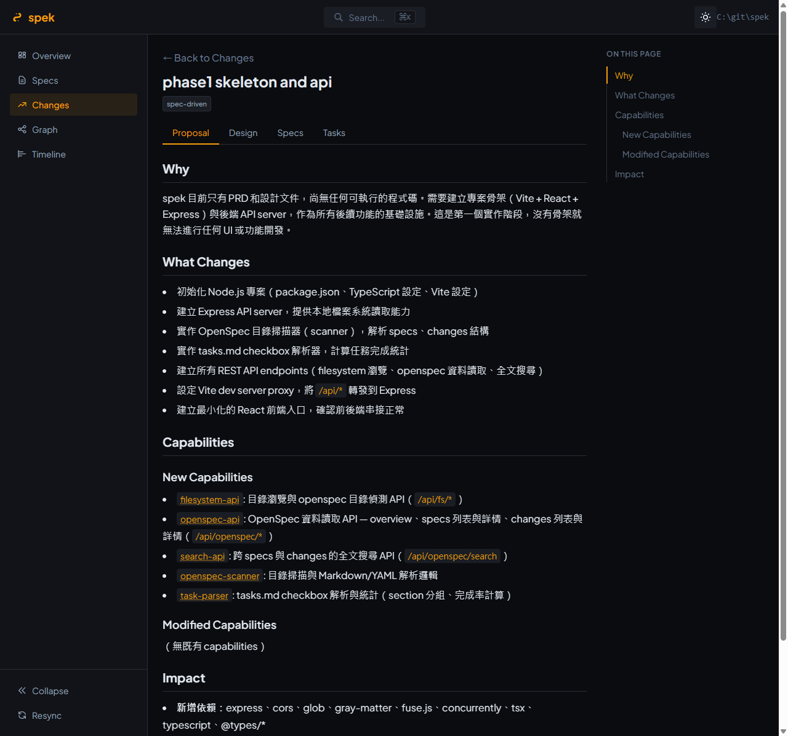

<p align="center">
  
</p>

<p align="center">
  A lightweight, read-only viewer for <a href="https://github.com/Fission-AI/OpenSpec">OpenSpec</a> content — browse specs, changes, and tasks with structure.
</p>

<p align="center">
  
  
  
</p>

**[繁體中文](README.zh-TW.md)**

---

## What is spek?

**spek** turns a repository's `openspec/` directory into something you can browse: specs as an outline,
changes with their proposal, design, tasks and delta specs as tabs, workflow schemas, a graph and a timeline,
and full-text search. It only reads; it never changes a file.

- **[Live Demo](https://spekterm.com/spek/demo/)** — spek showing its own OpenSpec, in your browser, no install needed.
- **[Website](https://spekterm.com/spek/)** and **[user guide](https://spekterm.com/spek/docs/)** — in
  English and Traditional Chinese.



## Highlights

- **Dashboard** — specs, changes, task completion, average lifecycle, and changes that have gone stale
- **Specs** — a folder tree nested as `openspec/specs/` is on disk; a spec opens as an outline with its
  requirements and scenarios folded in place, and its revision history from git
- **Changes** — active and archived, one tab per artifact the change contains, whatever schema it was
  written under
- **Schemas, graph, timeline** — each workflow schema drawn as a flow, how specs and changes relate, and
  every change's lifecycle on a Gantt-style chart
- **Worktree aggregation** — the in-flight changes of every git worktree in one list, deduplicated (jj
  workspaces as an experimental option) — built for agents working in parallel
- **BDD highlighting, task progress, `Cmd+K` / `Ctrl+K` search, dark and light themes**

What each view shows: [Browsing](https://spekterm.com/spek/docs/using/browsing/) ·
[Worktree aggregation](https://spekterm.com/spek/docs/using/worktrees/).

## Four ways to run it

All four show the same views and are read-only. The first three are local-only: no server deployment, no
account, and nothing about your repository leaves your machine
([Data and network](https://spekterm.com/spek/docs/reference/data-and-network/)).

| Form | Get it |
|---|---|
| **VS Code extension** — a panel and a sidebar in your editor | [Visual Studio Marketplace](https://marketplace.visualstudio.com/items?itemName=kewang.spek-vscode) |
| **JetBrains plugin** — a tool window in IntelliJ IDEA, WebStorm, PyCharm and other JetBrains IDEs | [JetBrains Marketplace](https://plugins.jetbrains.com/plugin/30600-spek--openspec-viewer) |
| **Web app** — runs from this repository's source, in your browser | see below |
| **GitHub Action** — builds a static spek page and status badges in CI | [GitHub Marketplace](https://github.com/marketplace/actions/spek-openspec-static-site), see below |

Install steps, commands and settings for each: [Install spek](https://spekterm.com/spek/docs/getting-started/install/).

### Web app

```bash
git clone https://github.com/spekhq/spek.git
cd spek
npm install
npm run dev
```

Open http://localhost:5173, enter the path of a repository containing an `openspec/` directory, and browse.

### GitHub Action

```yaml
- uses: actions/checkout@v7
  with:
    fetch-depth: 0  # full history, for the changes' dates

- uses: spekhq/spek@v1
  with:
    title: "My Project - OpenSpec"
```

| Input | Description | Default |
|-------|-------------|---------|
| `repo-path` | Path to the repo containing `openspec/` | `.` |
| `output-path` | Output HTML file path | `spek-output/spek.html` |
| `title` | Page title | `OpenSpec Viewer` |
| `spek-version` | spek version (tag, branch, or SHA) | `master` |
| `generate-badges` | Generate SVG badge files | `false` |

| Output | Description |
|--------|-------------|
| `html-path` | Absolute path to the generated HTML file |
| `badges-path` | Absolute path to the generated badges directory |

Deploying the page to GitHub Pages and adding the badges to your README:
[GitHub Action and badges](https://spekterm.com/spek/docs/using/github-action/).

### Live reload in containers (devcontainer / WSL)

spek watches `openspec/` and reloads on changes. On filesystems that deliver no native change events — 9p /
drvfs / NFS / CIFS mounts, as devcontainers and WSL use — it falls back to polling on its own. To override:
`SPEK_WATCH_POLLING=on` (or `off`) for every form; the Web app and VS Code also honour chokidar's
`CHOKIDAR_USEPOLLING=1` / `CHOKIDAR_INTERVAL=<ms>`.

## spek and spekterm

[spekterm](https://github.com/spekhq/spekterm) is spek's sibling project, from the same maintainers: a
desktop workbench that runs Claude Code sessions for each of your repositories in one window, with the
OpenSpec change each one is working on shown right beside the terminal. Its side panel stands on spek:

- **The engine that reads OpenSpec** — scanning specs and changes, task progress, and worktree aggregation
  come from [`@spekjs/core`](https://www.npmjs.com/package/@spekjs/core).
- **The Graph and the Timeline** — the same components spek draws, from
  [`@spekjs/ui`](https://www.npmjs.com/package/@spekjs/ui).

Use spek to read specs where you already work — your browser, your editor, your CI. Use spekterm when you
drive agents across repositories and want the spec beside them. They read the same files, and neither
needs the other. Both live at [spekterm.com](https://spekterm.com).

## Contributing

Contributions are welcome — from typo fixes to features across the Web, VS Code, and IntelliJ
surfaces. Start with the [Contributing Guide](CONTRIBUTING.md) for setup, conventions, and the
pull-request process.

- [Contributing Guide](CONTRIBUTING.md) — dev setup, conventions, how to open a PR
- [Code of Conduct](CODE_OF_CONDUCT.md)
- [Security Policy](SECURITY.md) — how to report a vulnerability privately

How the repository is laid out and built, and the two packages it publishes to npm, are in the
Contributing Guide too.

## Acknowledgments

This project was inspired by [龍哥（高見龍）](https://kaochenlong.com)'s articles on SDD (Spec Driven Development). Special thanks to him for his contributions to SDD and [OpenSpec](https://github.com/Fission-AI/OpenSpec).

- [SDD — Spec Driven Development](https://kaochenlong.com/sdd-spec-driven-development)
- [Spectra with OpenSpec](https://kaochenlong.com/spectra-with-openspec)

## Contributors

Thanks to everyone who has contributed to spek:

- [@nthansen](https://github.com/nthansen) (Norman Hansen)
  - **Custom schema support** — a change's artifacts are discovered from disk, so any schema renders its own tabs; each change carries a schema badge judged against its own worktree's default, and tabs sort by last-modified / schema order / A–Z, with the authoritative order taken from the OpenSpec CLI and cached per schema
  - **Non-Markdown artifacts** — a change's root `.yaml` / `.yml` / `.json` files render as their own syntax-highlighted tabs, sorting into the position their schema declares, counted in the change-list badge and reachable by search; code fences inside the Markdown artifacts are highlighted through the same pipeline
  - **The Schemas pages** — a list of what every available schema defines, and a detail view drawing one as a readable flow, including the steps a schema produces only after implementation
  - **Markdown fidelity** — a task's continuation lines survive the parser and render as Markdown, list markers stay inline with their item's first line, and TOC / `#hash` navigation lands the target heading below the sticky header
  - **Platform reach** — polling live-reload for filesystems without native change events (devcontainer / WSL / network mounts), and build scripts that work under Windows `cmd.exe`
  - **Removal of the web server's unreferenced `server/lib/` copies** of the core scanning logic, which shadowed `@spekjs/core` as a second place the same rules could drift

- [@david-lutz](https://github.com/david-lutz) (David Lutz)
  - Deduplication of active changes shared across git worktrees, in both the Changes list and the dependency graph — the surviving copy is elected from git divergence rather than file timestamps, which a fresh checkout rewrites

- [@DannyGoodall](https://github.com/DannyGoodall) (Danny Goodall)
  - Experimental Jujutsu (jj) workspace aggregation — changes authored in a jj workspace, invisible to `git worktree list`, are discovered and merged into the aggregated view, deduplicated by content with diverged copies kept and flagged

- [@Katsz](https://github.com/Katsz) (Alex)
  - Added and removed lines in a spec diff keep their red / green tint across the whole scrollable width, instead of losing it past the first screenful on lines too wide to fit

- [@flatrick](https://github.com/flatrick) (Patrik)
  - Nested spec folders — a `spec.md` at any depth under `openspec/specs/` is discovered by OpenSpec's own rule and browsable on every surface as a folder tree, with every spec read confined to the specs a scan lists
  - A `verify-vscode` skill for checking spek inside a real VS Code window — reading, clicking and screenshotting what the panel and sidebar actually render, on desktop and in a browser-hosted VS Code

- [@gokul-kulkarni](https://github.com/gokul-kulkarni) (Gokul Kulkarni)
  - **Mermaid diagrams** — a ` ```mermaid ` block in any Markdown artifact, and a `.mmd` / `.mermaid` file at a change's root, are drawn as diagrams themed from spek's palette, with zoom, pan and a source view, and a diagram that fails to parse shows its error beside its source

- [@sammcj](https://github.com/sammcj) (Sam McLeod)
  - Graph labels no longer land on other nodes — the layout makes room for each label, fills a wide window and comes out the same on every load
  - Pages declare English as their language, so browsers stop offering to translate them and pick the right fallback fonts

## License

MIT

## Trademarks and brand assets

The MIT license above applies to the source code. It does **not** grant any right to use the
spek name, logo, or other brand assets in `logo/`. All rights to those are reserved.

You may use them to refer to the spek project — in an article, a talk, a list of tools. You may
not use them to identify your own product, service, or a modified distribution, or in any way
that suggests endorsement by or affiliation with this project.
